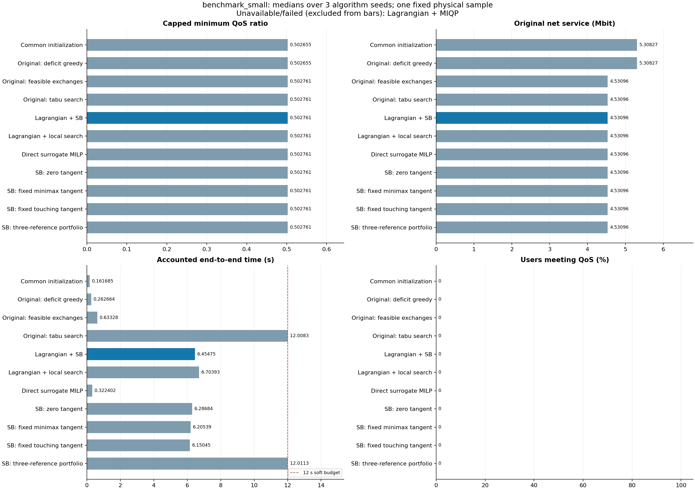
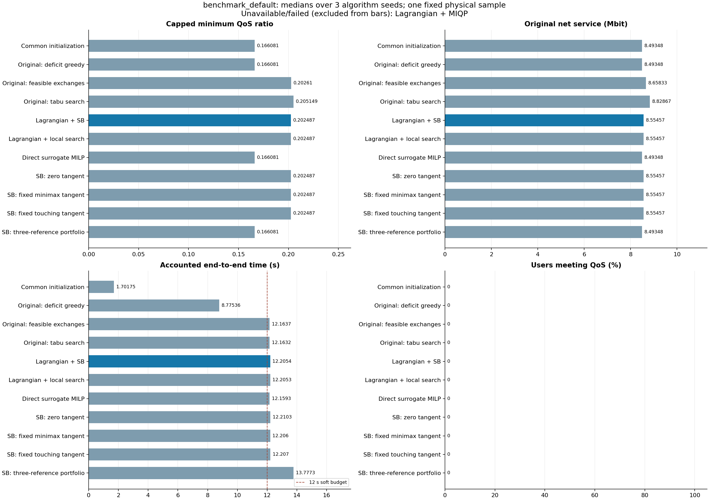

# 实测对比结果

本页保留上一轮结果。新增迭代记录后的重跑和 18 类完整图组见 [PLOTS.md](PLOTS.md)，两轮计时不混合统计。

运行与复核日期：2026-11-05 至 2026-11-06（Asia/Shanghai）。GNU Octave 9.4.0，Linux x86_64，OpenBLAS 单线程；MATLAB 本体未运行。
固定物理种子 20261104，算法种子 20261105/20261106/20261107；每方法端到端软预算 12 s。
两个规模均为 32 个固定波束、最多并发 8 人、每块 50 ms。以下质量与时间为三次运行的中位数。
每个规模 33 次成功返回并通过原始硬约束验收；Gurobi MIQP 缺失的 3 次记录为 unavailable，运行错误为 0。
这是同一物理样本上的三次搜索实验，不是大样本性能结论，也不代表 MATLAB 原生耗时。

## 8 用户 / 3 块

| 方法 | 原始公平 | 原始总服务 Mbit | 端到端核算 s | 最大预算超额 s |
|---|---:|---:|---:|---:|
| 共同初始化 | 0.502655349 | 5.308269 | 0.162 | 0.000 |
| 原目标缺口贪心 | 0.502655349 | 5.308269 | 0.263 | 0.000 |
| 原目标可行交换 | 0.502761118 | 4.530960 | 0.633 | 0.000 |
| 原目标禁忌搜索 | 0.502761118 | 4.530960 | 12.008 | 0.008 |
| 拉格朗日 + SB | 0.502761118 | 4.530960 | 6.455 | 0.000 |
| 拉格朗日 + 局部搜索 | 0.502761118 | 4.530960 | 6.704 | 0.000 |
| 拉格朗日 + MIQP | 未运行：Gurobi 不可用 | — | — | — |
| 直接代理 MILP | 0.502761118 | 4.530960 | 0.322 | 0.000 |
| SB：零切点 | 0.502761118 | 4.530960 | 6.287 | 0.000 |
| SB：固定 minimax | 0.502761118 | 4.530960 | 6.205 | 0.000 |
| SB：固定当前切点 | 0.502761118 | 4.530960 | 6.150 | 0.000 |
| SB：三参考点组合 | 0.502761118 | 4.530960 | 12.011 | 0.011 |

[逐次记录](examples/benchmark_small/runs.csv) · [完整汇总](examples/benchmark_small/summary.csv) · [用户服务](examples/benchmark_small/user_service.csv) · [完整日程](examples/benchmark_small/schedules.csv)

## 32 用户 / 20 块

| 方法 | 原始公平 | 原始总服务 Mbit | 端到端核算 s | 最大预算超额 s |
|---|---:|---:|---:|---:|
| 共同初始化 | 0.166080659 | 8.493479 | 1.702 | 0.000 |
| 原目标缺口贪心 | 0.166080659 | 8.493479 | 8.775 | 0.000 |
| 原目标可行交换 | 0.202609600 | 8.658330 | 12.164 | 0.199 |
| 原目标禁忌搜索 | 0.205148609 | 8.828667 | 12.163 | 0.206 |
| 拉格朗日 + SB | 0.202486683 | 8.554573 | 12.205 | 0.206 |
| 拉格朗日 + 局部搜索 | 0.202486683 | 8.554573 | 12.205 | 0.218 |
| 拉格朗日 + MIQP | 未运行：Gurobi 不可用 | — | — | — |
| 直接代理 MILP | 0.166080659 | 8.493479 | 12.159 | 0.159 |
| SB：零切点 | 0.202486683 | 8.554573 | 12.210 | 0.218 |
| SB：固定 minimax | 0.202486683 | 8.554573 | 12.206 | 0.206 |
| SB：固定当前切点 | 0.202486683 | 8.554573 | 12.207 | 0.209 |
| SB：三参考点组合 | 0.166080659 | 8.493479 | 13.777 | 1.843 |

[逐次记录](examples/benchmark_default/runs.csv) · [完整汇总](examples/benchmark_default/summary.csv) · [用户服务](examples/benchmark_default/user_service.csv) · [完整日程](examples/benchmark_default/schedules.csv)

## 结果解释

小算例完整穷举 16,777,216 个合法日程，公平最优值 0.502761117852874，严格公平优先下的总服务 4.530959579630668 Mbit。
该次穷举求解约 2.082 s（不含共同物理建模）。SB、交换、禁忌、局部搜索、直接 MILP 及各切点消融均取得了与原始穷举最优相同的公平值和吞吐量。
其中直接 MILP 和原目标交换更快；本实验不支持小规模上 SB 比这些方法更快的结论。

初始化的总服务是 5.308269 Mbit，公平为 0.502655349；严格公平优先为很小的公平改善付出了总服务下降。
这符合基础 O2/O4 目标，并不是把 q_i 当作业务上限。加入吞吐底线会改变问题，属于尚未实施的第 20 节扩展。

32 用户算例中，SB 将共同初始化公平 0.166080659 提高到 0.202486683；同代理局部搜索取得相同结果。
本次预算下原目标禁忌搜索的中位公平 0.205148609 略高。大算例的有效公平上界约为 0.330039731，SB 的界差约 0.127553047，尚未认证最优。
完整日程数约 6.90521×10^130，穷举明确返回规模超限。不能以这些有限次运行声明全局最优或普遍加速。

大算例直接 MILP 的 GLPK 两阶段记录为超时（error 9），适配器未返回通过检查的新解，因此输出保留的共同初始化。
三参考点组合的重复初始化/代理构造耗时明显，最大超额约 1.843 s，且未改善初始化；该行不作为严格同耗时的性能证据。
其他大算例搜索的软预算超额约 0.14–0.22 s；全部实际耗时与超额均已保留，未裁剪成 12 s。

所有最终保存日程通过硬约束与各自阶段 2 公平门槛检查。两种规模中的最终日程均没有用户达到 1 Mbit 需求（达标率为 0），
公平值提高不等于满足所有 QoS。当前有效公平上界小于 1，也说明这组默认需求与资源下无法让所有用户同时达标。

完整 MAT 数值快照位于压缩包 results/benchmark_small/benchmark.mat 和 results/benchmark_default/benchmark.mat。
图由 tools/plot_benchmark_csv.py 从同一 CSV 绘制；MATLAB 绘图函数为 leo_plot_benchmark。
复现实验命令与指标定义见 [BENCHMARKS.md](BENCHMARKS.md)，可选扩展边界见 [IMPLEMENTATION_STATUS.md](IMPLEMENTATION_STATUS.md)。
