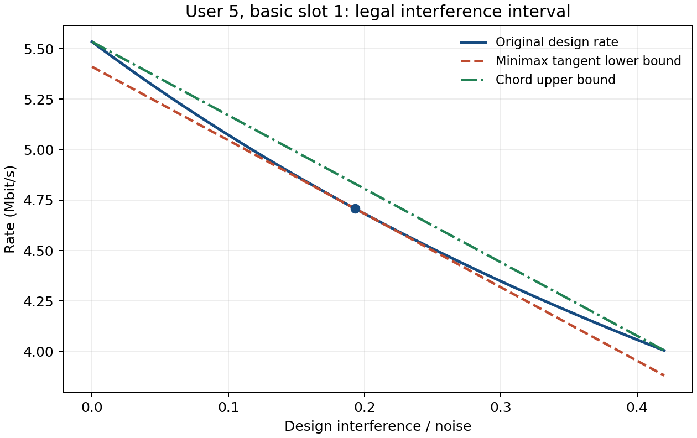

# 切线下界、弦线上界与二次服务

实现方案第 7.1–7.5 节和第 11.1–11.2 节的误差量。
保留原始模型、风险预算、32 波束/8 并发和 50 ms 固定块。
本轮仅构造和验证代理，不求解代理问题，不加入拉格朗日、QUBO、SB 或可选多层切线编码。

## 运行与入口

默认主函数现在自动构造 minimax 切线及弦线上界：

```matlab
addpath('matlab');
model = run_leo_sinr();
proxy = model.surrogate;
lowerA = proxy.lower.aBits;           % K x M
lowerB = proxy.lower.bBits;           % K x K x M
upperA = proxy.upper.aBits;
upperB = proxy.upper.bBits;
check = leo_evaluate_service_bounds(model.problem,proxy,model.xExample);
```

在已有合法日程 x0 处相切：

```matlab
x0 = model.problem.precheck.witness; % 也可用以后算法提供的合法日程
touching = leo_build_service_surrogates(model.problem,'current_schedule',x0);
check = leo_evaluate_service_bounds(model.problem,touching,x0);
check.lowerGapBits                  % 每用户的 D_i - lower_D_i，应为数值零
```

若将 `p.surrogate.referenceMode='current_schedule'` 传入主函数，它使用正公平预检见证为 x0。
默认 `minimax` 不依赖任何日程；两种模式都不读取未来瞬时衰落。
`model.problem` 中的原始 O2/O4 回调仍计算原式，代理单独保存在 `model.surrogate`。

## 合法干扰区间 T2–T3

对选中用户 i，只考虑自身码字之外、当前资源实际有候选用户的其他波束。
固定每流功率下同一波束服务哪个用户，其对 i 的干扰系数相同。
将这些波束的设计系数降序排列，取最大的至多 L−1 项之和作为 Imax。

这对应条件 **x_i=1 且整个组满足硬约束**。既不能把同波束的多个用户重复计干扰，
也不能把“平均干扰”当作全局区间。
对未选用户计算的反事实干扰可能超过该条件上限，例如其他 L 个用户已经占满容量。
因此当前日程相切时，只给被选用户使用实际干扰；未选用户回退到合法 minimax 切点。

`leo_interference_limits` 输出 K×T 的 `maxW` 与有效事件掩码。
零净数据时间、不可用位置、L=1 或没有其他可用波束均得到正确的零区间。

## 标量速率、切线和弦线 T1、T4、T7

以下 S、c 均为第 5 节低分位设计系数，不是瞬时 Z 缩放的样本系数：

\[
r(I)=B\log_2\left(1+\frac S{N+I}\right),\qquad
r'(I)=-\frac{BS}{\ln2\,(N+I)(N+I+S)}.
\]

r 对非负干扰递减且凸。切点为 Ibar 时：

\[
\ell(I)=\alpha-\omega I,\quad
\omega=-r'(\bar I),\quad\alpha=r(\bar I)+\omega\bar I.
\]

由凸性，ell≤r。切线可能为负，代码保留负值；将其截成 max(0,ell) 会失去单个二次多项式结构。

对 [a,b] 上的弦线：

\[
\mu=\frac{r(b)-r(a)}{b-a},\qquad
u(I)=r(a)+\mu(I-a)=\alpha_U-\omega_U I,
\]

其中 omega_U=−mu、alpha_U=r(a)+omega_U*a。在 [a,b] 内有 r≤u。
主流程一律使用 **[0,Imax]**，覆盖每个合法激活组；标量函数支持一般区间，但不提供区间外的上界保证。

## 默认最小最坏误差切线 T8–T10

选择 r'(Ibar)=mu，切线与弦线平行：

\[
\bar I=\frac{\sqrt{S^2+4BS/[(-\mu)\ln2]}-S}{2}-N.
\]

令 delta=u(Ibar)−r(Ibar)，则区间内

\[
\ell(I)\le r(I)\le u(I),\qquad
0\le r(I)-\ell(I)\le\delta,\qquad
0\le u(I)-r(I)\le\delta.
\]

这条切线在该标量速率的仿射下界类中最小化最坏误差，不声称所有全周期二次代理中最优。
程序同时保存曲率界 `max(r'')*(b-a)^2/8`。

### 数值实现

链路功率常在 1e−14 W 附近，不能用固定绝对 `eps` 将非零区间当成零。
实现先用 N+a 归一化，令 s=S/(N+a)、h=(b-a)/(N+a)。
弦线速率差用稳定恒等式

\[
r(a)-r(b)=\frac B{\ln2}\log\left(1+\frac{sh}{1+s+h}\right)
\]

计算；切点使用 T8 的有理化等价式，避免相近数相减。
当区间严格退化或 S=0 时直接处理。误差量中的 `max(0,...)` 只保护数值误差量，**不截断切线或服务下界**。
计算和验证仍是双精度数值结果，并非区间算术证书。

## 按基本槽累加为二次服务 T5–T6

用户组及码字块内固定，但每槽系数和切点分别计算：

\[
a_{im}=\sum_{t\in\mathcal I_m}d_t\alpha_{it},\quad
b_{ijm}=\sum_{t\in\mathcal I_m}d_t\omega_{it}c_{ij,t},\quad b_{iim}=0.
\]

\[
\underline D_{im}=a_{im}x_{im}-\sum_{j\ne i}b_{ijm}x_{im}x_{jm}.
\]

弦线上界使用同样的汇总方式，得到上界 a、b。
b_ij 表示用户 j 对受干扰用户 i 的损失，通常不对称；它不是直接供 SB 使用的对称 Ising 矩阵。
两个代理都只有已有 x 的二次项，没有新增用户对变量。

`leo_evaluate_quadratic_service` 返回资源/周期服务、总量和需求比例。
若下界的固定日程公平分数为负，表示该日程在代理约束中没有满足 s≥0 的公平比例，
不能将这个分数默默截成零后标为代理可行。空日程仍提供代理问题的零公平可行点。

## 当前日程相切

被选用户取 Ibar=I(x0)，因此每用户周期下界在 x0 处与原式相等。
构造函数实际核对该相等关系；未选用户对应 x_i=0，参考点使用 minimax 不影响相等关系。
弦线上界沿用完整合法区间，不随参考日程缩小。

不要把多个切线逐点取最大值，或裁剪负切线后，仍当成一个单独的二次表达式。
本实现没有可选多层切线编码。

## 服务误差 E1–E3

任意切点下，r−ell 为凸函数，最大误差在区间端点达到。代码直接用两个端点求 delta_L。
弦线上界的最大误差 delta_U 在 minimax 点达到。
默认 minimax 模式中两者相同至浮点误差；当前日程模式需重新计算下界误差。

\[
0\le D_i-\underline D_i\le\epsilon_i,\qquad
\epsilon_i=\sum_{m:v_{im}=1}\sum_{t\in\mathcal I_m}d_t\delta_{L,it}.
\]

`proxy.error.lowerUserBits` 是覆盖所有合法日程的用户误差预算；上界有对应 `upperUserBits`。
给定日程的检查器会进一步只累计选中资源的预算。
`optimalFairnessGapBound=min(1,max(epsilon_i/q_i))` 对应基准 O2 与固定二次代理**各自最优值**的理论差距界。
它不是某个任意日程的最优性证书，也不证明 SB 达到了代理最优；未扩展到第 20 节吞吐底线问题。

## 输出字段与函数

| 字段 | 含义 |
|---|---|
| `limits.maxW` | K×T，条件合法干扰上限 |
| `minimaxReferenceW` / `referenceW` | 最小最坏误差切点 / 本次实际使用切点 |
| `tangent.alphaBps` / `omegaBpsPerW` | 下界截距 / 非负负斜率幅值 |
| `chord.alphaBps` / `omegaBpsPerW` | 弦上界截距 / 非负负斜率幅值 |
| `lower.aBits` / `lower.bBits` | 下界 K×M 一次系数 / K×K×M 二次损失 |
| `upper.aBits` / `upper.bBits` | 上界对应系数 |
| `rateError.lowerMaxBps` / `upperMaxBps` | 单用户基本槽的速率误差上限 |
| `error.lowerResourceBits` / `lowerUserBits` | 下界资源/周期服务误差预算 |
| `error.optimalFairnessGapBound` | E3：两最优值差距的界，未求解代理 |
| `referenceTouchMaxAbsBits` | 当前点相切的最大用户服务数值误差；minimax 模式为 NaN |

独立函数包括 `leo_rate_and_derivatives`、`leo_interference_limits`、`leo_tangent_lower`、
`leo_chord_upper`、`leo_schedule_interference`、`leo_assemble_quadratic_service`、
`leo_build_service_surrogates`、`leo_evaluate_quadratic_service` 和 `leo_evaluate_service_bounds`。

## 与已有穷举结果对照

```matlab
[model,comparison] = run_leo_surrogate_demo();
```

该入口保留 8 用户/3 块小例，完整穷举原始问题，然后在同一最优日程上比较：

| 构造 | 下界总服务 / Mbit | 原始总服务 / Mbit | 弦上界总服务 / Mbit |
|---|---:|---:|---:|
| minimax 切线 | 4.480411921 | 4.530959580 | 4.537407533 |
| 在该日程相切 | 4.530959580 | 4.530959580 | 4.537407533 |

`leo_check_surrogate_groups` 对每个资源的全部合法组检查逐用户夹逼与误差预算。
这个算例每资源 256 组，共实际检查 768 组；由于服务对资源可加，检查涵盖其全部 16,777,216 个完整日程组合的服务界。
它没有逐一遍历所有完整日程去检查界，也没有求解代理问题。
弦上界检查仅适用于原硬约束下的二元选择；连续松弛或违反人数/波束约束的点不能直接使用这份证书。

本轮在 GNU Octave 9.4.0 通过 12 组新增检查及原有 36 组回归检查，尚未在 MATLAB 本体运行。

验证数据在 `examples/surrogate_comparison.csv`、`surrogate_user_bounds.csv`、
`surrogate_summary.json`，标量曲线数据为 `surrogate_rate_curve.csv`。
交付 ZIP 另附 `examples/surrogate_demo.mat`，包含去除函数句柄的 `snapshot` 和完整对比结构 `comparison`。
本次当前点相切的最大用户服务误差约为 1.16e−10 bit，位于双精度舍入量级。


